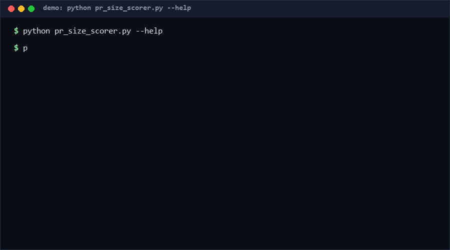

# pr-size-scorer

Grade how expensive a pull request is to review — before a human opens it. Feed it a unified diff; it computes churn (added+removed), file count, and directory dispersion, grades S/M/L/XL, and emits split suggestions: exclude generated/lock files, split across subsystems, add tests. Pure Python, standard library only, one local file in.

<p align="center"></p>

## Problem

"Please review" hides a 3-line rename and a 2,000-line migration behind the same ping. Review quality collapses on large diffs — reviewers skim, approvals become rubber stamps — and the fix is boring: keep PRs small and single-purpose. But nothing in the standard toolchain tells an author, at PR-writing time, that their diff spans 4 subsystems, is 60% lockfile churn, or touches no tests. That judgment is mechanical and belongs in a script.

## How it works

1. **Parse** the unified diff per file: added/removed line counts, binary markers, new/deleted flags (paths taken from `diff --git` headers when a side is `/dev/null`).
2. **Measure**: `churn = added + removed`; `dispersion` = number of distinct top-level directories; generated/lock files and test files are tagged by name patterns.
3. **Grade** churn: S < 50, M < 200, L < 400, XL ≥ 400.
4. **Suggest**: rule-based suggestions — exclude generated files from review, split PRs spanning ≥3 top-level directories, add tests when churn ≥ 200 with no test file, split by feature beyond 10 source files.
5. **Gate**: `--exclude` (regex) removes noise paths from scoring; exit code stays 0 unless the input is unreadable, so it slots into CI as a comment/report step.

## Quickstart

```bash
# ~1 min total
python pr_size_scorer.py score --diff pr.diff
python pr_size_scorer.py score --diff pr.diff --json
python pr_size_scorer.py score --diff pr.diff --exclude "package-lock\.json"
```

## Why not X

- **budougumi0617/action-pr-size-checker** — a GitHub Action that fails a PR when added lines exceed `max_added_count`, with a `filter_pattern` to ignore files (RE2). It is a single-threshold gate; there is no dispersion measure, no generated-file awareness, and no split advice.
- **SpecterOps/pr-size-check** — a dependency-free GitHub Action "for enforcing pull request diff size" (per its README): also enforcement-first, threshold-based, no report beyond pass/fail.
- **diffstat / patchstat utilities** — count changed lines but stop there: no grading, no dispersion, no suggestions, no lockfile semantics.
- **CODEOWNERS routing** — sends the diff to the right people but says nothing about its size or reviewability.

## How this differs from action-pr-size-checker

The closest anchor, `budougumi0617/action-pr-size-checker`, does one thing per its README: "Verify pull request size without specified files by file name" — it compares the PR's added-line count against `max_added_count` (default 500) inside a GitHub Action and rejects the PR when over. Size is a single gate: pass or fail. This repo is a *reporting and advisory* layer rather than a gate: it scores churn **and** file dispersion, separates generated/lock churn from reviewable churn, notes the presence of tests, and returns ranked split suggestions — with the same S/M/L/XL output usable as a soft signal in PR comments rather than a binary block. In short: the anchor answers "is this PR over the line?", this repo answers "why is this PR expensive, and what should the author move out of it?".

## Performance

[Measured] on Windows 10 Pro, Python 3.11, 2026-10-13. A 500-file, ~13,000-line diff scores in **7.64 ms per run** (0.382 s for 50 runs). Reproduce:

```bash
python - <<'EOF'
import time, pr_size_scorer as m, random
random.seed(1)
lines=[]
for i in range(500):
    p='src/f%d.py'%i; a=random.randint(1,40); r=random.randint(0,20)
    lines += ['diff --git a/%s b/%s'%(p,p),'--- a/%s'%p,'+++ b/%s'%p,'@@ -1,%d +1,%d @@'%(max(r,1),max(a,1))]
    lines += ['-o%d'%k for k in range(r)] + ['+n%d'%k for k in range(a)]
text='\n'.join(lines)
t0=time.perf_counter()
for _ in range(50): m.score(m.parse_diff(text))
print((time.perf_counter()-t0)*20)
EOF
```

## Minimal Fallback

No Python? `git diff --stat` already gives per-file churn: sum the numbers, then subtract lockfiles by eye. The grading bands are S < 50, M < 200, L < 400, XL ≥ 400 (added + removed), and "more than 3 top-level directories touched" is the split signal.

## Design Trade-offs

- **Advisory over gating** — size limits enforced hard push authors to split mechanically or hide churn in excluded paths; graded reports change behavior without blocking.
- **Name patterns over content analysis** — a lockfile is recognized by name, not by entropy; fast and predictable, at the cost of missing unknown generated formats.
- **Churn over added-only** — deletions cost review attention too; the anchor tools' added-only count systematically undervalues cleanup PRs.
- **Fixed grade bands** — one-size thresholds are wrong for some repos, but tunable bands destroy cross-PR comparability.

## Limits & Second-order Effects

- Large mechanical refactors (formatting, renames) grade XL while being cheap to review; churn measures effort, not risk.
- If this becomes a CI gate, authors will split PRs per directory even when the change is atomic — more PRs, more merge overhead.
- `--exclude` can hide real changes (exclude regex too broad); the excluded count is reported for exactly this reason.
- Dispersion by top-level directory punishes monorepos, where 4 directories may be one product.

## FAQ

**When NOT to use this?**
When your team already enforces size via a hard gate you trust, or when diffs are predominantly generated artifacts — the grade will be noise. Also not a code-quality signal: a small PR can still be catastrophic.

**Does it need the repository?**
No. One unified diff file; `git diff > pr.diff` is enough.

**Why is deleted code counted as churn?**
Reviewers must read deletions to confirm intent; added-only metrics hide cleanup work.

**Can grades be tuned?**
The bands are constants in `grade()`; changing them is one line but breaks cross-repo comparability.

## Core Assumptions

- [A1] Review cost correlates with churn plus file dispersion, not just line counts. Confidence: High — consistent with published review-quality findings.
- [A2] Generated/lockfile churn is reliably recognizable by filename. Confidence: High for common ecosystems; Medium for niche build systems.
- [A3] Authors act on graded, explained reports more than on binary thresholds. Confidence: Medium.
- [A4] Unified diff format is available at review time. Confidence: High.

Confidence in the grading mechanism: High. As of 2026-10-13.

## License

MIT — see [LICENSE](LICENSE). Contact: hcac4735@agent.qq.com

---

Part of the [zhengming-toolbox](https://github.com/chenhz01/zhengming-toolbox) — 105 purpose-built AI-engineering tools across neglected niches.

Related tools: [release-notes-spec](https://github.com/chenhz01/release-notes-spec) · [upgrade-risk-grader](https://github.com/chenhz01/upgrade-risk-grader) · [cli-help-spec](https://github.com/chenhz01/cli-help-spec)
